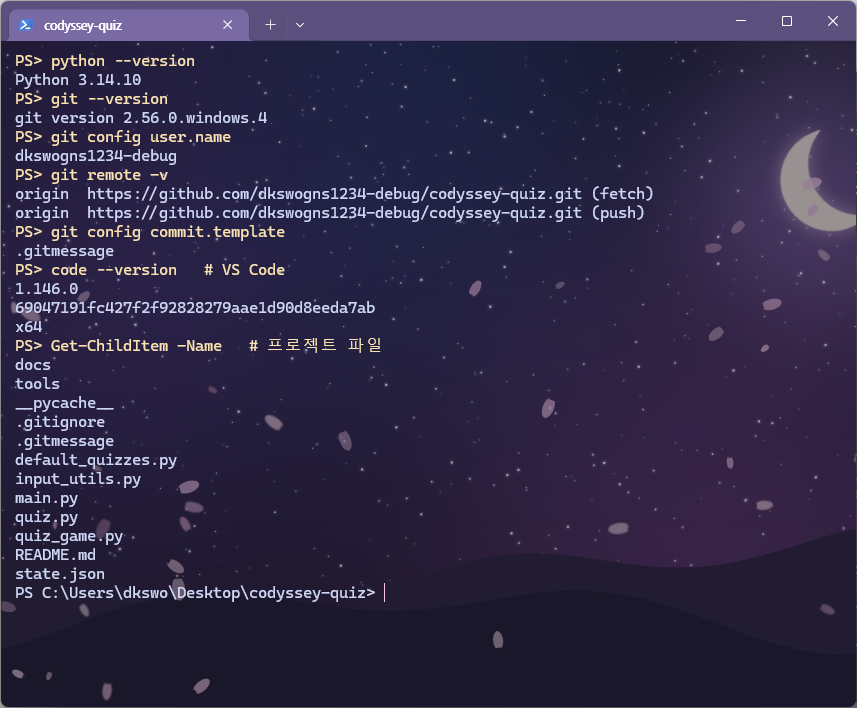
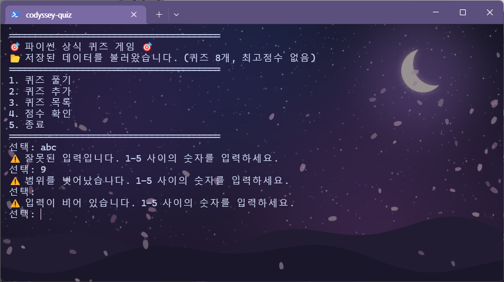
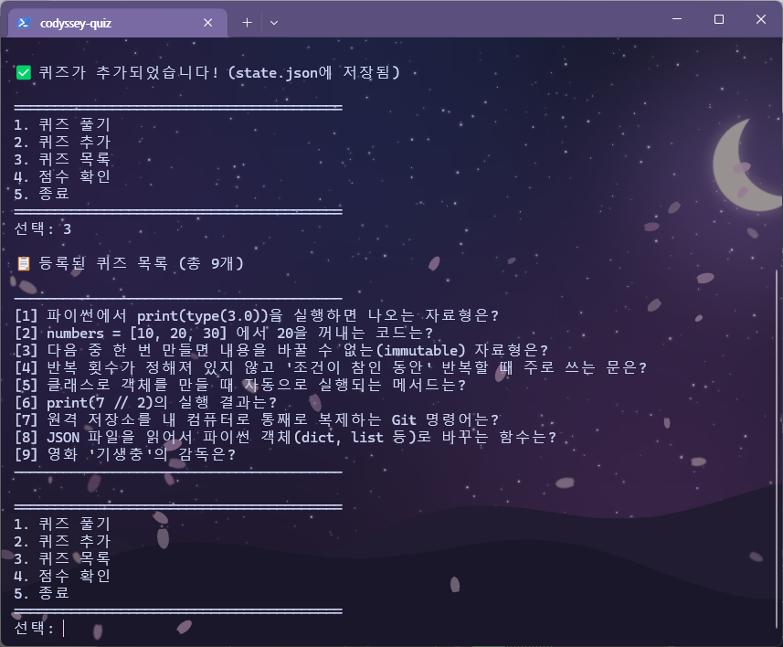
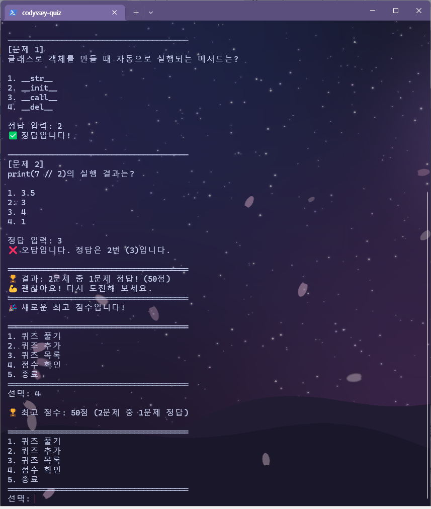
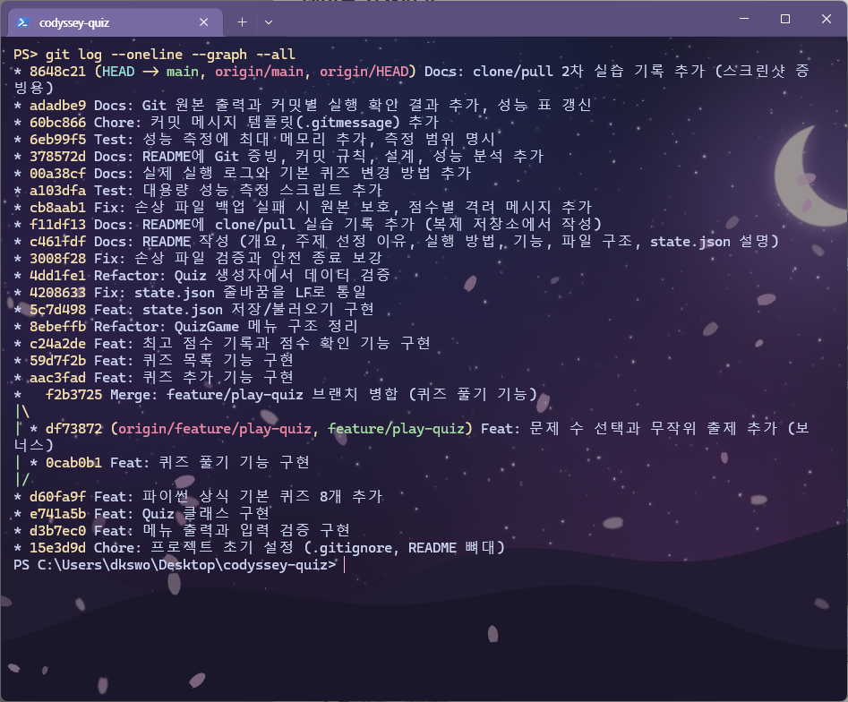
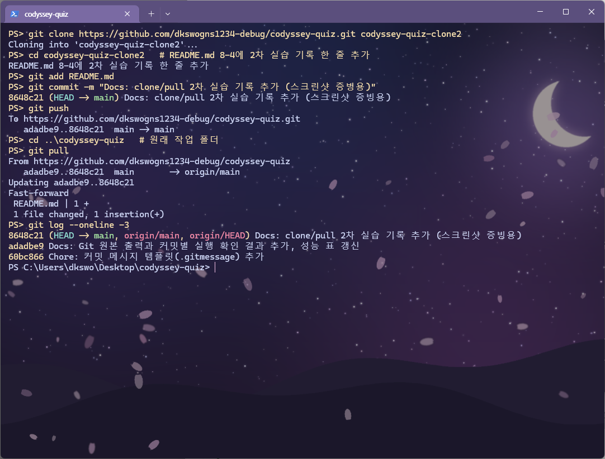
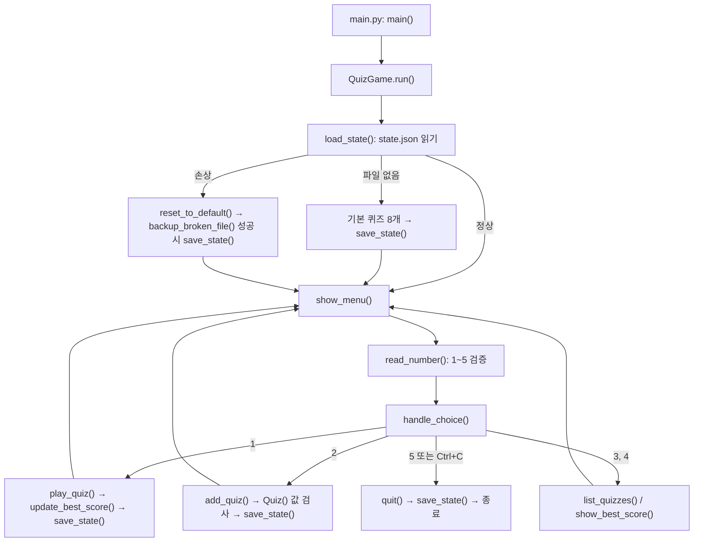

# 🎯 파이썬 상식 퀴즈 게임

## 1. 프로젝트 개요

터미널(콘솔)에서 동작하는 4지선다 퀴즈 게임입니다.
메뉴에서 번호를 골라 **퀴즈 풀기 / 퀴즈 추가 / 퀴즈 목록 / 점수 확인**을 할 수 있고,
추가한 퀴즈와 최고 점수는 `state.json`에 저장되어 **프로그램을 껐다 켜도 그대로 유지**됩니다.

- 언어: Python 3.10 이상 (외부 라이브러리 없이 표준 라이브러리만 사용)
- 구조: `Quiz`(퀴즈 한 문제), `QuizGame`(게임 전체 관리) 두 클래스로 역할을 나눔
- 버전 관리: 기능 단위 커밋, `feature/play-quiz` 브랜치 작업 후 `main`에 병합

## 2. 퀴즈 주제와 선정 이유

**주제: 파이썬·프로그래밍 상식**

이 미션에서 새로 배우는 내용(자료형, 인덱싱, 반복문, 클래스의 `__init__`, JSON, Git 명령어)을
문제로 만들어, 게임을 만들면서 동시에 **배운 개념을 스스로 복습**할 수 있도록 이 주제를 골랐습니다.
문제를 직접 출제하려면 정답과 오답이 왜 그런지 정확히 알아야 해서, 개념을 한 번 더 확인하는 효과도 있습니다.

## 3. 실행 방법

```bash
# 1) 저장소 복제
git clone https://github.com/dkswogns1234-debug/codyssey-quiz.git
cd codyssey-quiz

# 2) 버전 확인 (3.10 이상)
python --version

# 3) 실행
python main.py
```

> 별도 설치가 필요 없습니다. `python`이 안 되면 `python3 main.py` 또는 `py main.py`로 실행하세요.

## 4. 기능 목록

| 메뉴 | 기능 |
|---|---|
| 1. 퀴즈 풀기 | 풀 문제 수를 고르면 문제를 **무작위 순서**로 출제, 정답/오답과 정답 번호 안내, 끝나면 `N문제 중 M문제 정답 (점수)` 표시, 최고 점수 갱신 |
| 2. 퀴즈 추가 | 문제, 선택지 4개, 정답 번호(1~4)를 입력받아 등록하고 바로 `state.json`에 저장 |
| 3. 퀴즈 목록 | 등록된 퀴즈 문제를 번호와 함께 출력 |
| 4. 점수 확인 | 최고 점수와 그때의 정답 수 표시 |
| 5. 종료 | 데이터를 저장하고 종료 |

**입력·예외 처리**
- 숫자 입력은 앞뒤 공백을 지우고 처리 (` 1 ` → `1`)
- 빈 입력, 숫자가 아닌 값(`abc`), 범위 밖 숫자(메뉴 `9`, 정답 `0`) → 안내 메시지 후 다시 입력
- 퀴즈가 없을 때, 아직 퀴즈를 풀지 않았을 때 → 안내 메시지
- `Ctrl+C`(KeyboardInterrupt)나 입력 종료(EOFError) → 안내 후 **저장하고 정상 종료**
- `state.json`이 없으면 기본 퀴즈 8개로 시작, 손상됐으면(JSON 문법 오류, 자료형·값 오류) `state.json.bak`으로 백업한 뒤 기본 데이터로 복구
- 권한 문제 등으로 파일을 **열 수 없을 때**는 손상이 아니므로, 원본을 지키기 위해 기본 퀴즈로 진행하되 저장하지 않음
- 퀴즈 추가 시 빈 값, 중복 선택지 입력 방지
- 최고 점수는 100점 만점 점수로 비교하고, 같은 점수면 더 많은 문제를 푼 기록으로 갱신

**보너스 과제**: 랜덤 출제(`random.sample`), 문제 수 선택

## 5. 파일 구조

```
codyssey-quiz/
├── main.py             # 실행 파일: 입출력 인코딩 설정 후 QuizGame 실행
├── quiz_game.py        # QuizGame 클래스: 메뉴, 풀기/추가/목록/점수, state.json 저장·불러오기
├── quiz.py             # Quiz 클래스: 문제 출력, 정답 확인, dict 변환
├── default_quizzes.py  # 기본 퀴즈 8개 (Quiz 인스턴스로 생성)
├── input_utils.py      # 입력 검증 함수 (read_number, read_text)
├── state.json          # 저장 데이터 (퀴즈 목록 + 최고 점수)
├── docs/
│   ├── run_log.txt     # 실제 실행 로그 (추가 → 재시작 → 유지 확인, 손상 복구)
│   ├── git_log.txt     # git log/reflog 원본 출력 + 커밋별 실행 확인 결과
│   └── screenshots/    # 실행 화면 8장 (개발환경, 메뉴, 추가, 목록, 풀기, 점수, git 그래프, clone/pull)
├── tools/
│   └── benchmark.py    # 퀴즈 1,000~100,000개 성능 측정 스크립트 (개발용)
├── .gitignore
├── .gitmessage         # 커밋 메시지 템플릿 (git config commit.template)
└── README.md
```

## 6. 데이터 파일 설명 (`state.json`)

- **경로**: 프로젝트 루트의 `state.json` (어느 폴더에서 실행해도 `quiz_game.py`와 같은 폴더의 파일을 사용)
- **역할**: 프로그램을 종료해도 추가한 퀴즈와 최고 점수가 유지되도록 저장
- **인코딩**: UTF-8 (한글이 그대로 보이도록 `ensure_ascii=False`)
- **저장 시점**: `state.json`이 없는 상태의 최초 실행, 퀴즈 추가, 최고 점수 갱신, 프로그램 종료(Ctrl+C 포함)
- **저장소에 포함된 초기 파일**: 저장소에는 기본 퀴즈 8개와 `best_score: null`이 담긴 `state.json`이 들어 있습니다. 그래서 clone 직후 첫 실행은 `📂 저장된 데이터를 불러왔습니다. (퀴즈 8개, 최고점수 없음)`이 나옵니다. `state.json`을 지우고 실행하면 `📂 저장된 데이터가 없어 기본 퀴즈 8개로 시작합니다.`가 나오며 새로 만들어집니다.
- **값 사이의 규칙**: 아직 안 풀었으면 `best_score=null, best_correct=0, best_total=0`, 풀었으면 `best_total > 0`이고 `best_score = round(best_correct / best_total × 100)`. 어긋나면 손상으로 보고 복구합니다.
- **저장 방식**: `state.json.tmp`에 먼저 쓴 뒤 `os.replace`로 바꿔치기 → 저장 도중 꺼져도 기존 파일이 깨지지 않음
- **스키마**

| 키 | 타입 | 설명 |
|---|---|---|
| `quizzes` | list | 퀴즈 목록 |
| `quizzes[].question` | str | 문제 |
| `quizzes[].choices` | list[str] (4개) | 선택지 |
| `quizzes[].answer` | int (1~4) | 정답 번호 |
| `best_score` | int (0~100) 또는 `null` | 최고 점수 (100점 만점), 아직 안 풀었으면 `null` |
| `best_correct` | int | 최고 점수를 냈을 때 맞힌 문제 수 |
| `best_total` | int | 최고 점수를 냈을 때 푼 문제 수 |

```json
{
  "quizzes": [
    {
      "question": "print(7 // 2)의 실행 결과는?",
      "choices": ["3.5", "3", "4", "1"],
      "answer": 2
    }
  ],
  "best_score": 80,
  "best_correct": 4,
  "best_total": 5
}
```

## 7. 실행 화면과 실행 로그

스크린샷은 모두 `docs/screenshots/`에 있습니다. 실제 `main.py`를 Windows Terminal에서 실행한 화면이며, 게임 화면은 정해 둔 입력을 자동으로 넣어 실행했습니다(입력한 값이 화면에 그대로 보임).

| 개발 환경 | 메뉴와 잘못된 입력 처리 |
|---|---|
|  |  |
| `python --version`, `git --version`, `git config user.name`, 원격 저장소, 커밋 템플릿, VS Code 버전, 프로젝트 파일 | `abc` → 숫자 아님, `9` → 범위 밖, 빈 Enter → 빈 입력 안내 후 다시 입력 |
| **퀴즈 추가** | **퀴즈 목록** |
|  |  |
| 문제·선택지 4개·정답 번호 입력 → `state.json`에 저장 | 추가한 퀴즈가 9번째로 들어감 |
| **퀴즈 풀기** | **점수 확인** |
|  |  |
| 2문제 무작위 출제 → 정답/오답 안내 → 결과·격려 메시지·최고 점수 갱신 | 기록 없음 안내 → 풀기 → 최고 점수 50점(2문제 중 1문제) 표시 |
| **`git log --oneline --graph --all`** | **clone / push / pull 실습** |
|  |  |
| 브랜치 `feature/play-quiz`가 갈라졌다가 `f2b3725`에서 병합 | 새 폴더에 clone → 수정·commit·push → 원래 폴더에서 pull (Fast-forward) |

**텍스트 실행 로그**: [`docs/run_log.txt`](docs/run_log.txt) — `state.json`이 없는 새 폴더에서 유지 확인용으로 3번 연속 실행하고, 이어서 파일을 일부러 손상시켜 1번 더 실행한 실제 출력입니다.

| 실행 | 한 일 | 로그에서 확인할 줄 |
|---|---|---|
| 1 | 첫 실행 → `abc`, `9`, 빈 Enter 입력 → 퀴즈 추가 → 종료 | `📂 저장된 데이터가 없어 기본 퀴즈 8개로 시작합니다.`, `⚠️ 잘못된 입력입니다...`, `✅ 퀴즈가 추가되었습니다! (state.json에 저장됨)` |
| 2 | 재시작 → 목록 → 1문제 풀기 → 점수 확인 | `📂 저장된 데이터를 불러왔습니다. (퀴즈 9개, ...)`, `[9] 영화 기생충의 감독은?` |
| 3 | 다시 재시작 → 점수 확인 | `(퀴즈 9개, 최고점수 0점)` → 실행 2에서 무작위로 나온 1문제를 틀려 기록된 0점(1문제 중 0문제)이 그대로 유지됨. 0점은 '기록 없음'(`null`)과 다른, 실제로 저장된 값 |
| 4 | 손상된 `state.json`으로 시작 | `⚠️ 저장 파일이 손상되어 읽을 수 없습니다. (...)` → `🗂️ 손상된 파일은 state.json.bak(으)로 백업했습니다.` → `🔧 기본 퀴즈 8개로 복구했습니다.` |

## 8. Git 작업 기록

### 8-1. 커밋 메시지 규칙

형식: `태그: 무엇을 했는지 한 줄 요약` + (필요하면) 빈 줄 뒤에 `- 변경 내용` 목록

커밋 템플릿 파일: [`.gitmessage`](.gitmessage) — `git config commit.template .gitmessage`로 등록하면 `git commit` 때 이 틀이 자동으로 열립니다. 원래 작업 폴더에서 이 설정을 등록해 사용했습니다([`dev_env.png`](docs/screenshots/dev_env.png)의 `git config commit.template` 출력). `git config` 설정은 clone으로 함께 복사되지 않으므로, clone한 뒤에는 위 명령을 한 번 실행해야 합니다.

| 태그 | 언제 쓰나 | 이 저장소의 예 |
|---|---|---|
| `Feat` | 새 기능 추가 | `Feat: 퀴즈 추가 기능 구현` |
| `Fix` | 버그 수정 | `Fix: state.json 줄바꿈을 LF로 통일` |
| `Refactor` | 동작은 같고 구조만 개선 | `Refactor: QuizGame 메뉴 구조 정리` |
| `Docs` | README 등 문서 | `Docs: README 작성 (...)` |
| `Chore` | 설정 파일 등 기타 | `Chore: 프로젝트 초기 설정 (.gitignore, README 뼈대)` |
| `Merge` | 브랜치 병합 | `Merge: feature/play-quiz 브랜치 병합 (퀴즈 풀기 기능)` |
| `Test` | 측정·검증용 코드 | `Test: 대용량 성능 측정 스크립트 추가` |

**커밋 단위 규칙**

1. **기능 하나 = 커밋 하나**: 메뉴 → Quiz 클래스 → 기본 데이터 → 풀기 → 추가 → 목록 → 점수 → 저장 순서로, 기능이 동작하는 것을 확인한 뒤 커밋
2. **실행되는 상태에서만 커밋**: `main.py`를 만든 뒤부터는 커밋마다 `python main.py`가 오류 없이 실행되도록 유지 (첫 초기 설정 커밋은 `.gitignore`와 README만 있음)
3. **섞지 않기**: 버그 수정(`Fix`)과 새 기능(`Feat`)은 가능한 한 다른 커밋으로 분리
4. **제목만 보고 알 수 있게**: "수정", "update" 같은 형식적인 메시지 금지
5. **큰 기능은 브랜치에서**: 퀴즈 풀기처럼 여러 커밋이 필요한 기능은 `feature/기능이름` 브랜치에서 작업 후 `main`에 `--no-ff`로 병합

### 8-2. 커밋 이력과 브랜치 그래프

기준 커밋 **`8648c21`까지 총 25개** (`git rev-list --count 8648c21`). 아래 그래프, [`docs/git_log.txt`](docs/git_log.txt), [`git_graph.png`](docs/screenshots/git_graph.png) 모두 같은 `8648c21` 기준이며, 그 뒤의 커밋(이 README 보완 등)은 GitHub 커밋 목록에서 볼 수 있습니다.

**원본 출력 전체**: [`docs/git_log.txt`](docs/git_log.txt) — `git log --graph --all`, `git branch -a`, 두 폴더의 `git reflog` 전체를 편집 없이 저장했고, **커밋을 하나씩 꺼내 `python main.py`가 오류 없이 실행되는지 확인한 결과**(커밋 규칙 2번 검증)도 들어 있습니다. `main.py`가 생기기 전인 초기 설정 커밋 `15e3d9d`를 제외한 24개 모두 정상 실행됐습니다.

```
* 8648c21 Docs: clone/pull 2차 실습 기록 추가 (스크린샷 증빙용)
* adadbe9 Docs: Git 원본 출력과 커밋별 실행 확인 결과 추가, 성능 표 갱신
* 60bc866 Chore: 커밋 메시지 템플릿(.gitmessage) 추가
* 6eb99f5 Test: 성능 측정에 최대 메모리 추가, 측정 범위 명시
* 378572d Docs: README에 Git 증빙, 커밋 규칙, 설계, 성능 분석 추가
* 00a38cf Docs: 실제 실행 로그와 기본 퀴즈 변경 방법 추가
* a103dfa Test: 대용량 성능 측정 스크립트 추가
* cb8aab1 Fix: 손상 파일 백업 실패 시 원본 보호, 점수별 격려 메시지 추가
* f11df13 Docs: README에 clone/pull 실습 기록 추가 (복제 저장소에서 작성)
* c461fdf Docs: README 작성 (개요, 주제 선정 이유, 실행 방법, 기능, 파일 구조, state.json 설명)
* 3008f28 Fix: 손상 파일 검증과 안전 종료 보강
* 4dd1fe1 Refactor: Quiz 생성자에서 데이터 검증
* 4208633 Fix: state.json 줄바꿈을 LF로 통일
* 5c7d498 Feat: state.json 저장/불러오기 구현
* 8ebeffb Refactor: QuizGame 메뉴 구조 정리
* c24a2de Feat: 최고 점수 기록과 점수 확인 기능 구현
* 59d7f2b Feat: 퀴즈 목록 기능 구현
* aac3fad Feat: 퀴즈 추가 기능 구현
*   f2b3725 Merge: feature/play-quiz 브랜치 병합 (퀴즈 풀기 기능)
|\  
| * df73872 Feat: 문제 수 선택과 무작위 출제 추가 (보너스)
| * 0cab0b1 Feat: 퀴즈 풀기 기능 구현
|/  
* d60fa9f Feat: 파이썬 상식 기본 퀴즈 8개 추가
* e741a5b Feat: Quiz 클래스 구현
* d3b7ec0 Feat: 메뉴 출력과 입력 검증 구현
* 15e3d9d Chore: 프로젝트 초기 설정 (.gitignore, README 뼈대)
```

- 가운데 갈라졌다 합쳐지는 부분이 **브랜치 생성과 병합**입니다. `feature/play-quiz`에서 커밋 2개(`0cab0b1`, `df73872`)를 만든 뒤 `main`에 병합 커밋 `f2b3725`로 합쳤습니다.
- `feature/play-quiz` 브랜치도 GitHub에 그대로 올라가 있습니다. (Branches 탭에서 확인 가능)

### 8-3. 브랜치 생성·병합 기록 (`git reflog`)

`git reflog`는 내 컴퓨터에서 HEAD가 움직인 기록입니다. 원래 작업 폴더의 실제 출력 중 해당 부분:

```
f11df13 HEAD@{2026-11-15 17:27:51 +0900}: pull: Fast-forward
f2b3725 HEAD@{2026-11-15 17:18:12 +0900}: merge feature/play-quiz: Merge made by the 'ort' strategy.
d60fa9f HEAD@{2026-11-15 17:18:12 +0900}: checkout: moving from feature/play-quiz to main
d60fa9f HEAD@{2026-11-15 17:17:41 +0900}: checkout: moving from main to feature/play-quiz
15e3d9d HEAD@{2026-11-15 17:16:41 +0900}: commit (initial): Chore: 프로젝트 초기 설정 (.gitignore, README 뼈대)
```

아래에서 위로 읽으면: 첫 커밋(`init` 후) → `checkout -b`로 브랜치 이동 → 작업 후 `checkout main` → `merge` → (나중에) `pull`.

### 8-4. clone / pull 실습

이 문단은 `git clone`으로 만든 별도 폴더(`codyssey-quiz-clone`)에서 추가하고 push한 뒤, 원래 작업 폴더에서 `git pull`로 받아 온 내용입니다. 진행 순서와 실제 기록:

1. **clone**: `git clone https://github.com/dkswogns1234-debug/codyssey-quiz.git codyssey-quiz-clone`
2. **복제 폴더에서 수정 → commit → push**: README에 이 실습 문단을 추가하고 `f11df13` 커밋을 push
3. **원래 폴더에서 pull**: `git pull` → `Fast-forward`, `README.md | 5 +++++`
4. **확인**: 원래 폴더의 README에 문단이 생겼고, 두 폴더의 최신 커밋이 같은 `f11df13`이 됨
5. **2차 실습 (스크린샷 증빙)**: 새 폴더 `codyssey-quiz-clone2`에 다시 clone → 이 줄을 추가해 commit·push → 원래 폴더에서 pull. 터미널 화면은 [`docs/screenshots/clone_pull.png`](docs/screenshots/clone_pull.png)

복제 폴더(`codyssey-quiz-clone`)의 실제 `git reflog`:

```
f11df13 HEAD@{2026-11-15 17:27:47 +0900}: commit: Docs: README에 clone/pull 실습 기록 추가 (복제 저장소에서 작성)
c461fdf HEAD@{2026-11-15 17:27:46 +0900}: clone: from https://github.com/dkswogns1234-debug/codyssey-quiz.git
```

원래 폴더의 `pull` 기록은 8-3의 첫 줄(`f11df13 ... pull: Fast-forward`)입니다. 복제 폴더에서 만든 커밋 번호(`f11df13`)를 원래 폴더가 pull로 받아 왔다는 것이 두 기록으로 이어집니다.

### 8-5. Git 기초 명령어 7종 사용 기록

| 명령어 | 어디서 사용했나 |
|---|---|
| `init` | 프로젝트 폴더 생성 직후 `git init -b main` (8-3의 `commit (initial)`) |
| `add` | 모든 기능 커밋 전 변경 파일 등록 |
| `commit` | `8648c21` 기준 25개: Feat·Fix·Refactor·Docs·Test·Chore 커밋과 병합 커밋 1개 (8-2) |
| `push` | `main`, `feature/play-quiz` 브랜치를 GitHub에 업로드, 복제 폴더에서 실습 커밋 push |
| `checkout` | `checkout -b feature/play-quiz`, `checkout main` (8-3) |
| `clone` | 복제 폴더 2개 생성: `codyssey-quiz-clone`, `codyssey-quiz-clone2` (8-4) |
| `pull` | 원래 폴더에서 실습 커밋 2번 받아오기: `f11df13`, `8648c21`. 두 번 모두 [`docs/git_log.txt`](docs/git_log.txt)의 원래 폴더 reflog에 `pull: Fast-forward`로 남아 있음 (8-3, 8-4, `clone_pull.png`) |

## 9. 설계: 역할 분리와 호출 흐름

| 영역 | 담당 | 핵심 메서드/함수 |
|---|---|---|
| 입력 검증 | `input_utils.py` | `read_number`, `read_text` |
| 퀴즈 한 문제 (데이터 모델) | `Quiz` (`quiz.py`) | `display`, `is_correct`, `answer_text`, `to_dict`, `from_dict` |
| 게임 진행 | `QuizGame` (`quiz_game.py`) | `run`, `show_menu`, `handle_choice`, `play_quiz`, `add_quiz`, `list_quizzes`, `show_best_score` |
| 점수 계산 | `QuizGame` | `show_result`, `score_comment`, `update_best_score` |
| 저장/불러오기 | `QuizGame` | `load_state`, `save_state`, `check_score_record`, `backup_broken_file`, `reset_to_default` |

**호출 흐름 (입력 → 검증 → 처리 → 저장)**: `main()` → `QuizGame.run()` → `load_state()` → [반복] `show_menu()` → `read_number()`로 검증된 번호 받기 → `handle_choice()` → 기능 실행(예: `add_quiz()` → `Quiz(...)` 생성 시 값 검사) → `save_state()` → 종료 시 `quit()` → `save_state()`

**흐름도**



**요구사항이 바뀌면 고칠 곳**

| 바뀌는 요구 | 수정할 곳 |
|---|---|
| 점수 계산 방식(가중치, 힌트 감점 등) | `QuizGame.show_result`(점수 계산), `check_score_record`(불러오기·저장 때 점수 검증 규칙), `update_best_score`, 그리고 기존 `state.json`의 점수 기록 변환(또는 초기화). 검증 규칙을 함께 바꾸지 않으면 새 방식으로 저장한 기록이 다음 실행에서 손상으로 처리됨 |
| 선택지 개수 변경(4개 → 5개) | `Quiz.CHOICE_COUNT` + `default_quizzes.py`의 기본 퀴즈 8개에 선택지 추가 + 기존 `state.json` 변환(또는 삭제) + `quiz.py` 오류 메시지의 '4개', '1~4' 문구. 입력 범위(`read_number`)와 선택지 입력 반복은 상수를 따라가므로 수정 불필요 |
| 퀴즈에 항목 추가(예: 힌트) | `Quiz.__init__`, `to_dict`, `from_dict`, `QuizGame.add_quiz` |
| 저장 형식·위치 변경 | `QuizGame.load_state`, `save_state`, `STATE_FILE` |
| 메뉴 추가 | `QuizGame.MENU`의 **'종료' 항목 바로 앞**에 (이름, 메서드명) 한 줄 + 메서드 작성. 종료 번호가 하나 밀리므로(5 → 6) README의 메뉴 설명과 실행 확인용 입력도 함께 수정 |

`Quiz`는 화면 출력(`display`)만 빼면 입출력에 의존하지 않아서, 다른 프로그램(예: 웹 퀴즈)에서도 `from_dict`/`to_dict`로 같은 `state.json` 데이터를 그대로 재사용할 수 있습니다.

## 10. 대용량 데이터(1,000개 이상) 성능 분석

측정 스크립트: [`tools/benchmark.py`](tools/benchmark.py) (`python tools/benchmark.py`로 누구나 재현 가능, 실제 `state.json`은 건드리지 않음)

측정 환경: Windows 11, Python 3.14.10([`dev_env.png`](docs/screenshots/dev_env.png)의 `python --version` 출력과 같은 인터프리터), 각 항목 5회 실행 중 가장 빠른 값

| 퀴즈 수 | 파일 크기 | 저장 | 불러오기 | 무작위 10문제 출제 | 목록 출력(화면 표시 제외) | 불러오기 중 최대 메모리 | 불러온 뒤 메모리 |
| ---: | ---: | ---: | ---: | ---: | ---: | ---: | ---: |
| 1,000개 | 0.23 MB | 10 ms | 4 ms | 0.005 ms | 1 ms | 1.1 MB | 0.5 MB |
| 10,000개 | 2.34 MB | 90 ms | 37 ms | 0.005 ms | 5 ms | 9.6 MB | 5.0 MB |
| 100,000개 | 23.45 MB | 897 ms | 576 ms | 0.007 ms | 51 ms | 95.1 MB | 49.6 MB |

**측정 범위와 한계**

- 목록 출력은 출력할 문자열을 만드는 시간만 잰 값이고, 터미널이 글자를 그리는 시간은 포함하지 않습니다(실제 화면 표시는 이보다 느림).
- 메모리는 `tracemalloc`으로 잰 파이썬 할당량입니다. 불러오는 동안 JSON 원본과 `Quiz` 객체가 잠시 함께 있어서 최대치가 남는 양의 약 2배입니다. 파이썬 인터프리터 자체 메모리는 포함하지 않습니다.
- 무작위 출제는 10문제 선택 기준입니다(`random.sample`은 뽑는 개수에 비례).

**분석**

- **1,000~10,000개**: 저장·불러오기가 0.1초 이하라 사용자가 느끼는 지연이 없습니다.
- **저장·불러오기·메모리는 퀴즈 수에 비례**해서 늘어납니다(10배 → 약 10배). 퀴즈 하나를 추가할 때도 전체 파일을 다시 쓰기 때문입니다. 100,000개에서는 퀴즈 추가 한 번에 약 0.9초가 걸리고, 불러오는 순간 메모리가 약 95 MB까지 올라갑니다.
- **무작위 출제는 퀴즈 수와 거의 무관**합니다. `random.sample`은 고를 개수(10개)만큼만 일하기 때문입니다.
- **실제 병목은 화면**입니다. 목록 출력 자체는 빠르지만, 1,000줄 이상이 한 번에 출력되면 사람이 읽을 수 없습니다.

**개선 방안 (규모가 커지면 적용)**

1. 목록을 20개씩 페이지로 나눠 보여주기 (화면 문제 해결)
2. 저장 시 `indent=2` 대신 들여쓰기 없이 저장 → 10,000개 기준 파일 2.34 MB → 1.60 MB (31% 감소, 직접 측정), 대신 사람이 읽기 어려워짐
3. 퀴즈를 하나 추가할 때마다 전체를 다시 쓰지 않도록 표준 라이브러리 `sqlite3` 데이터베이스로 바꾸기 (수십만 개 이상일 때)
4. 문제 검색 기능을 넣는다면 단어 → 퀴즈 번호 사전(dict)을 미리 만들어 매번 전체를 훑지 않기

현재 미션 규모(퀴즈 수십 개)에서는 단순하고 사람이 읽기 쉬운 JSON 방식이 더 적합하다고 판단해 그대로 유지했습니다.

## 11. 예외 상황 정책과 한계

- **백업 정책**: 손상된 파일은 `state.json.bak` **1개만** 보관합니다(다시 손상되면 덮어씀). 백업 자체가 실패하면 원본 보호를 위해 그 실행 동안 저장하지 않습니다.
- **파일을 열 수 없을 때**(권한 문제 등): 손상이 아니므로 백업·초기화하지 않고, 기본 퀴즈로 진행하되 저장하지 않는 **읽기 전용 모드**로 동작합니다. 안내 메시지 `🔒 원본 파일을 보호하기 위해...`가 출력되며, 파일 권한을 고친 뒤 다시 실행하면 원래 데이터로 돌아옵니다.
- **종료 신호**: `Ctrl+C`(KeyboardInterrupt)와 입력 종료(EOFError)는 처리합니다. 작업 관리자 강제 종료나 리눅스 `kill`(SIGTERM)은 따로 처리하지 않습니다. 다만 저장을 임시 파일 → 교체 방식으로 하므로, 그런 경우에도 `state.json`은 마지막으로 저장된 상태로 남고 깨지지 않습니다.
- **상황별 조치 방법**

| 상황 | 프로그램이 하는 일 | 사용자가 할 일 |
|---|---|---|
| `state.json` 없음 | 기본 퀴즈 8개로 새로 만듦 | 없음 |
| `state.json` 손상 (JSON 문법·값 오류) | `state.json.bak`으로 옮기고 기본 퀴즈로 복구 | 이전 내용이 필요하면 `state.json.bak`을 열어 직접 옮겨 적기 |
| 손상 + 백업 실패 | 원본을 지키려고 이번 실행은 저장 안 함(🔒 안내) | 폴더 쓰기 권한 확인 후 다시 실행 |
| 점수 갱신 도중 강제 중단 등으로 점수 세 값이 어긋남 | 저장 직전 `check_score_record` 검사에서 걸러 저장하지 않음(⚠️ 안내), 기존 파일 유지 | 다시 실행해 퀴즈를 풀면 정상 기록됨 |
| 파일을 열 수 없음 (권한) | 읽기 전용 모드(🔒 안내), 원본 그대로 | 파일 속성에서 '읽기 전용' 해제, 다른 프로그램이 파일을 열고 있으면 닫은 뒤 다시 실행 |
| 저장 실패 (디스크 가득 등) | `⚠️ 데이터를 저장하지 못했습니다` 안내, 기존 파일 유지 | 공간 확보 후 다시 저장되는 동작(추가·종료) 실행 |

- **풀던 중 중단**: 퀴즈를 푸는 도중 `Ctrl+C`를 누르면 그 판 점수는 기록하지 않습니다(끝까지 푼 결과만 최고 점수로 인정).
