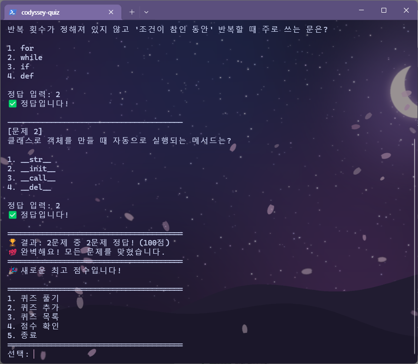
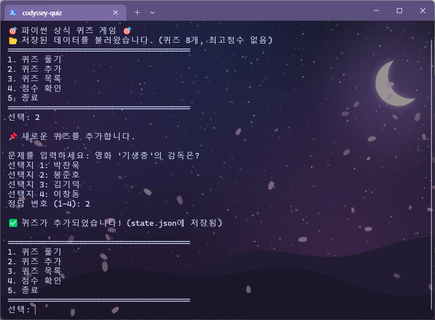

# 🎯 파이썬 상식 퀴즈 게임

## 1. 프로젝트 개요

터미널(콘솔)에서 동작하는 4지선다 퀴즈 게임입니다.
메뉴에서 번호를 골라 **퀴즈 풀기 / 퀴즈 추가 / 퀴즈 목록 / 점수 확인**을 할 수 있고,
추가한 퀴즈와 최고 점수는 `state.json`에 저장되어 **프로그램을 껐다 켜도 그대로 유지**됩니다.

- 언어: Python 3.10 이상 (외부 라이브러리 없이 표준 라이브러리만 사용)
- 구조: `Quiz`(퀴즈 한 문제), `QuizGame`(게임 전체 관리) 두 클래스로 역할을 나눔
- 버전 관리: 기능 단위 커밋, `feature/play-quiz` 브랜치 작업 후 `main`에 병합

## 2. 퀴즈 주제와 선정 이유

**주제: 파이썬·프로그래밍 상식**

이 미션에서 새로 배우는 내용(자료형, 인덱싱, 반복문, 클래스의 `__init__`, JSON, Git 명령어)을
문제로 만들어, 게임을 만들면서 동시에 **배운 개념을 스스로 복습**할 수 있도록 이 주제를 골랐습니다.
문제를 직접 출제하려면 정답과 오답이 왜 그런지 정확히 알아야 해서, 개념을 한 번 더 확인하는 효과도 있습니다.

## 3. 실행 방법

```bash
# 1) 저장소 복제
git clone https://github.com/dkswogns1234-debug/codyssey-quiz.git
cd codyssey-quiz

# 2) 버전 확인 (3.10 이상)
python --version

# 3) 실행
python main.py
```

> 별도 설치가 필요 없습니다. `python`이 안 되면 `python3 main.py` 또는 `py main.py`로 실행하세요.

## 4. 기능 목록

| 메뉴 | 기능 |
|---|---|
| 1. 퀴즈 풀기 | 풀 문제 수를 고르면 문제를 **무작위 순서**로 출제, 정답/오답과 정답 번호 안내, 끝나면 `N문제 중 M문제 정답 (점수)` 표시, 최고 점수 갱신 |
| 2. 퀴즈 추가 | 문제, 선택지 4개, 정답 번호(1~4)를 입력받아 등록하고 바로 `state.json`에 저장 |
| 3. 퀴즈 목록 | 등록된 퀴즈 문제를 번호와 함께 출력 |
| 4. 점수 확인 | 최고 점수와 그때의 정답 수 표시 |
| 5. 종료 | 데이터를 저장하고 종료 |

**입력·예외 처리**
- 숫자 입력은 앞뒤 공백을 지우고 처리 (` 1 ` → `1`)
- 빈 입력, 숫자가 아닌 값(`abc`), 범위 밖 숫자(메뉴 `9`, 정답 `0`) → 안내 메시지 후 다시 입력
- 퀴즈가 없을 때, 아직 퀴즈를 풀지 않았을 때 → 안내 메시지
- `Ctrl+C`(KeyboardInterrupt)나 입력 종료(EOFError) → 안내 후 **저장하고 정상 종료**
- `state.json`이 없으면 기본 퀴즈 8개로 시작, 손상됐으면(JSON 문법 오류, 자료형·값 오류) `state.json.bak`으로 백업한 뒤 기본 데이터로 복구
- 권한 문제 등으로 파일을 **열 수 없을 때**는 손상이 아니므로, 원본을 지키기 위해 기본 퀴즈로 진행하되 저장하지 않음
- 퀴즈 추가 시 빈 값, 중복 선택지 입력 방지
- 최고 점수는 100점 만점 점수로 비교하고, 같은 점수면 더 많은 문제를 푼 기록으로 갱신

**보너스 과제**: 랜덤 출제(`random.sample`), 문제 수 선택

## 5. 파일 구조

```
codyssey-quiz/
├── main.py             # 실행 파일: 입출력 인코딩 설정 후 QuizGame 실행
├── quiz_game.py        # QuizGame 클래스: 메뉴, 풀기/추가/목록/점수, state.json 저장·불러오기
├── quiz.py             # Quiz 클래스: 문제 출력, 정답 확인, dict 변환
├── default_quizzes.py  # 기본 퀴즈 8개 (Quiz 인스턴스로 생성)
├── input_utils.py      # 입력 검증 함수 (read_number, read_text)
├── state.json          # 저장 데이터 (퀴즈 목록 + 최고 점수)
├── .gitignore
└── README.md
```

## 6. 데이터 파일 설명 (`state.json`)

- **경로**: 프로젝트 루트의 `state.json` (어느 폴더에서 실행해도 `quiz_game.py`와 같은 폴더의 파일을 사용)
- **역할**: 프로그램을 종료해도 추가한 퀴즈와 최고 점수가 유지되도록 저장
- **인코딩**: UTF-8 (한글이 그대로 보이도록 `ensure_ascii=False`)
- **저장 시점**: 첫 실행, 퀴즈 추가, 최고 점수 갱신, 프로그램 종료(Ctrl+C 포함)
- **저장 방식**: `state.json.tmp`에 먼저 쓴 뒤 `os.replace`로 바꿔치기 → 저장 도중 꺼져도 기존 파일이 깨지지 않음
- **스키마**

| 키 | 타입 | 설명 |
|---|---|---|
| `quizzes` | list | 퀴즈 목록 |
| `quizzes[].question` | str | 문제 |
| `quizzes[].choices` | list[str] (4개) | 선택지 |
| `quizzes[].answer` | int (1~4) | 정답 번호 |
| `best_score` | int (0~100) 또는 `null` | 최고 점수 (100점 만점), 아직 안 풀었으면 `null` |
| `best_correct` | int | 최고 점수를 냈을 때 맞힌 문제 수 |
| `best_total` | int | 최고 점수를 냈을 때 푼 문제 수 |

```json
{
  "quizzes": [
    {
      "question": "print(7 // 2)의 실행 결과는?",
      "choices": ["3.5", "3", "4", "1"],
      "answer": 2
    }
  ],
  "best_score": 80,
  "best_correct": 4,
  "best_total": 5
}
```

## 7. 실행 화면

| 메뉴 | 퀴즈 풀기 |
|---|---|
|  |  |
| **퀴즈 추가** | **점수 확인** |
|  |  |

## 8. Git 복제 실습 기록

- 이 문단은 `git clone`으로 만든 별도 폴더(`codyssey-quiz-clone`)에서 추가하고 push한 뒤,
  원래 작업 폴더에서 `git pull`로 받아 온 내용입니다.
